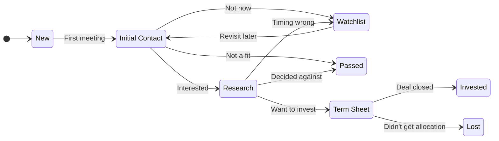

Buy a CRM you can adapt. A founder you passed on last year might be raising again, and whoever takes that meeting needs the notes, the introduction, and the reason you passed.

## Why CRMs Feel Terrible

CRM stands for Customer Relationship Management, which is a terrible name for what venture funds need. You're not managing customers. You're tracking relationships with founders, managing deal pipeline, coordinating your team, and maintaining institutional memory about every company you've ever talked to. But "relationship and deal flow management system" doesn't fit on marketing materials, so CRM it is.

The problem is that CRMs aren't built for venture capital specifically. They're built for sales organizations. Enterprise sales has standardized stages: lead, qualified, demo, proposal, negotiation, closed. You can forecast revenue based on conversion rates. Pipeline management means moving deals through predictable stages.

Venture doesn't work this way. You meet a founder. Maybe you pass. Three months later they email you an update. Six months after that you introduce them to a potential customer. A year later they're raising their next round and you lead it. Or you meet a founder, love them immediately, and invest in two weeks. The stages aren't linear. The timeline isn't predictable. The "deal" might not be a deal for years.

So CRMs force you to contort your process into their model. You create custom fields. You ignore half the features. You build workarounds. It never feels quite right. This is the reality of using CRMs in venture capital. They're better than the alternative (spreadsheets, scattered notes, institutional knowledge in people's heads), but they're never perfect.

## What You Actually Need

**Relationship tracking**: Every person you've met. Founders, operators, other investors, domain experts, potential LPs. How you met them. When you last talked. What you talked about. The context of your relationship. Six months from now, you should be able to look up someone and remember the full history.

**Company tracking**: Every company you've evaluated. How you met them. Who on your team has relationships with the founders. The full history of your interactions over time.

**Deal pipeline**: What deals (specific funding rounds) are active right now. Who's working on them. What stage they're at in your process. When decisions need to be made. What the next steps are.

<Tip>
  **Note on data modeling**: VCs invest in deals (specific funding rounds), not companies. Model
  your CRM at the deal level: "Acme Corp Seed Round" (Invested), "Acme Corp Series A" (Invested),
  "Acme Corp Series B" (Passed). If you model at the company level, you'll have problems when
  follow-on rounds come up - you can't mark a company as both "Invested" and "Passed" at the same
  time. I have first hand experience of trying to change this data model, it's a nightmare. Most
  good CRMs support this if you set it up correctly from the start.

See [Data Modeling](/guide/part-3-technical-foundations/data-modeling) for more information.

</Tip>

**Team coordination**: In a fund with multiple people, you need to know who's talking to which founders, who's working on which deals, and what everyone learned. The CRM prevents duplicate outreach, surfaces relevant context when someone else talked to a founder months ago, and helps the team build on each other's work.

**Search.** Can you find the founders you met at a conference six months ago, including those whose company has since changed its name?

**Beyond deal flow**: While this chapter focuses on deal flow management, many funds also use their CRM to manage LP relationships. Tracking interactions with current and potential LPs, managing fundraising pipelines, and maintaining investor reporting history. The same principles apply: relationship tracking, interaction history, and systematic follow-up. Some funds use separate systems for LPs, others use the same CRM with different pipelines.

## Choosing Your CRM

**Attio**: Modern, flexible, and designed with relationship-centric businesses in mind. Better UX than traditional CRMs. Strong customization without requiring a full-time admin. Good email and calendar integration. Pricing is reasonable for small to mid-sized funds. The main limitation is that it's less established than Affinity or Salesforce, so fewer integrations and smaller ecosystem, however the APIs are easy enough to work with if you need to add some "glue code" to integrate systems.

**Affinity**: Built specifically for relationship-driven industries like venture capital. Automatically enriches contact data and tracks relationship strength based on email and meeting patterns. Strong at surfacing "who knows who" for warm intros. More opinionated about workflow, which means less customization but faster setup.

**Salesforce**: The enterprise standard. Extremely customizable. Massive ecosystem of integrations and consultants. Can be configured to do almost anything. The downsides are cost (expensive for small funds), complexity (requires real admin overhead), and UX that feels dated.

**The decision**: Prioritize customizability over features. You'll need to adapt the CRM to match your fund's specific process. Attio and Affinity are both good choices for most funds. Attio if you want more control over structure and workflow. Affinity if you want VC-specific features. Salesforce only if you're large enough to have dedicated CRM admin resources.

<Note>
**Don't start with Airtable or Notion**

Many funds start with [Airtable](https://www.airtable.com/) or [Notion](https://www.notion.com/) for deal flow tracking because they're familiar, flexible, and easy to set up. This is a mistake.

The problem is that Airtable and Notion don't integrate well with email and calendar. You have to manually enter everything. What happens is that people stop updating it within weeks. You end up with a partially-filled database that nobody trusts or uses, and you've lost all the email and meeting history that a real CRM would have captured automatically.

Just buy a real CRM from the start. The cost is worth it for the automatic email and meeting tracking alone.

</Note>

## Making It Actually Work

**Integrate with your other tools**: The CRM should connect to your email (Gmail, Outlook), calendar, and other tools you use. When you email a founder, it logs automatically. When you have a meeting, it logs automatically. When you add a company to your sourcing tool, it flows into the CRM. The less manual data entry, the more people will actually use it.

Most CRMs have APIs. Use them. Build light integrations between your CRM and your research platform, your sourcing tools, and anything else you use. The CRM becomes more valuable when it's connected to the rest of your stack.

**Use it in deal flow calls**: The single most important habit. When your team discusses deal flow, have the CRM open. Update deal stages. Add notes. Assign next steps. If you talk about a company and don't update the CRM, information gets lost. Make it part of the meeting process, not something you do afterward.

**Commit to entering data**: There's no way around this. Someone needs to enter information about companies, founders, and meetings. With good email and calendar integration, a lot happens automatically. But initial company setup, notes from meetings that aren't on calendar, and context about relationships still require manual entry.

The key is making it low-friction. If entering data takes too many clicks or too many required fields, people won't do it. Customize the system to minimize friction while capturing what actually matters. Use integrations from meeting note taking apps like [Granola](https://www.granola.ai/) to also remove friction.

**Don't overthink the workflow**: Many funds spend weeks designing the perfect pipeline stages and custom fields. This is usually overengineering. Start simple. You can always add complexity later. The basics (who are we talking to, what stage are they at, what's the next step) cover 80% of what you need.

## Real Example: Attio at Inflection

Inflection chose Attio after evaluating several options. The deciding factors were customizability and ease of integration.

It took about a week to set up the funnel. Watchlist meant we wanted to revisit the company. Passed meant we’d decided against investing. Lost meant we wanted in but didn’t get an allocation. Keeping those outcomes separate let us see which deals to follow up on.

For the person running the pipeline meeting, those stages meant:

1. **New** - Something came into our pipeline
2. **Initial Contact** - Conversed over email and had the first call
3. **Research** - Diving deep, more meetings, talking with advisors
4. **Term Sheet** - Interested and extended a term sheet
5. **Invested** - Wired payment
6. **Watchlist** - Passed for now, but could be interested again later
7. **Passed** - Actually passed
8. **Lost** - Deals we wanted but didn't get allocation

