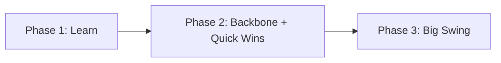

## Overview

You've now seen seven chapters covering different categories of tools and technology that venture funds use: research platforms, sourcing tools, CRM and deal flow management, fund operations, portfolio support, fundraising infrastructure, websites, and external presence. Each has value. Each can improve how your fund operates.

You don't need all of them immediately.

The biggest mistake new technical hires at VC funds make is trying to build everything at once. They see the full landscape of what's possible and want to implement a comprehensive tech stack from day one. This spreads resources too thin and delivers less value than focusing on fewer things done well.

This chapter is about sequencing. There are three phases: learn what your fund actually needs, build the backbone and quick wins, then decide on your big swing. Don't skip phases.

## Phase 1: Learn What Your Fund Needs First

Before you build anything significant, spend time [understanding your fund](/guide/part-1-understanding-vc/understanding-your-vc-fund). Observation comes before building.

**Talk to the people doing the work**: Meet with GPs and partners about how they find companies, make decisions, and track portfolio companies. Talk to the fund operations team about LP reporting and capital management. Ask what's painful right now, not what would be cool to have.

**Understand the thesis and strategy**: Is your fund thesis-driven or network-driven? Are you pre-seed or growth equity? Do you specialize in a specific vertical or geography? The answers dramatically change what technology matters. A thesis-driven fund needs research infrastructure. A network-driven fund needs relationship tracking. Don't assume what works at other funds works at yours.

**Identify the actual pain points**: Watch for what's actually broken or painful, not what people say would be nice to have. Is deal flow tracking chaotic? Is research getting lost? Are portfolio companies asking for help you can't deliver systematically? These are signals about where to invest.

**Don't assume**: Just because EQT built Motherbrain or Inflection built Kepler doesn't mean your fund needs the same thing.

This learning phase might take a few months. That's fine. Building the wrong thing wastes more time than taking time to understand what to build.

### When You Inherit a Stack That Nobody Really Uses

An established fund can have plenty of tools without getting much value from them. You arrive to find a CRM, several data subscriptions, a warehouse, and dashboards. On paper, the backbone exists. In practice, partners keep their own spreadsheets and nobody trusts the pipeline report.

Don't start by replacing the CRM. Find out why the current setup isn't working.

- **Inventory what actually runs**: List tools, costs, administrators, integrations, and renewal dates. Check when each sync last succeeded.
- **Follow one real workflow**: Watch a deal move from introduction to partner meeting. Where does information get entered twice? Where do people leave the system? Ask users to show you the last time they used it.
- **Identify trusted data**: Which system does the team rely on for deal status, company identity, and portfolio metrics? Agree on an authoritative source for each. Don't merge conflicting records blindly just to clean up a dashboard.
- **Assign ownership**: Someone needs to own deal updates and someone needs to own the integration that moves them. You can maintain the software, but you can't personally keep every investor's pipeline current.

Pick one workflow and repair it with someone who uses it every week. For example, fix the email sync, remove unnecessary required fields, and make the Monday pipeline report useful enough that the team stops preparing a separate spreadsheet. Review ambiguous duplicates with the deal team and keep a record of merges.

Measure whether the change sticks. Are active deals updated before the meeting? Has report preparation dropped from two hours to twenty minutes? Are people still maintaining a parallel tracker? Logins alone won't tell you whether you've solved the problem.

Once the workflow works, document it, train the team, and retire the duplicate process. Replace a tool when you've found a specific limitation that matters and can't reasonably fix it through configuration or integration. The quick win may be making something you've already paid for useful.

## Phase 2: Build the Backbone and Quick Wins

Once you understand your fund, start with two parallel tracks: the backbone (foundational infrastructure everyone needs) and quick wins (small tools that prove value).

**The backbone: CRM and fund operations**

These are non-negotiable infrastructure. Every fund needs to track deal flow and manage fund operations. Don't build these. Buy them.

**CRM**: See [CRM and Deal Flow](/guide/part-2-tech-stack/crm-and-deal-flow). If you already have one, repair the workflow before considering a replacement. If you don't, get one set up and make sure your team actually uses it. If adoption is low, you have a process problem to solve before building anything else.

**Fund operations**: See [Fund Operations](/guide/part-2-tech-stack/fund-operations). If you're Fund I with a small LP base, spreadsheets might work temporarily. But plan the migration before Fund II. Buy this off the shelf. Don't build fund operations software.

These aren't exciting projects, but they're essential. Get them working before anything else.

**Quick wins: small tools that build trust**

While implementing the backbone, build small tools that solve specific pain points and prove your value to the team. These establish credibility and help you understand what resonates.

Examples of quick wins:

- A simple dashboard showing portfolio company metrics pulled from your CRM
- Automating a painful manual process (generating LP reports, tracking follow-on opportunities)
- A lightweight research workflow improvement (better way to organize market maps, easier way to share insights)
- Customer discovery prospect lists for portfolio companies (using data from PitchBook or LinkedIn)

Quick wins should take days or weeks, not months. They should be immediately useful without requiring behavior change from the team.

Quick wins also give you a place to test technology before committing to a larger project.

## Phase 3: Decide on Your Big Swing

After you've built the backbone and delivered quick wins, you've earned the credibility and understanding to take on one big project. This is where you differentiate.

You get one big swing. Maybe it's a research platform. Maybe it's sophisticated sourcing infrastructure. Maybe it's portfolio support tools. Choose based on where your fund's competitive advantage actually is, not what sounds impressive. And maybe you don't need a big swing at all. Many successful funds operate with minimal technology beyond the backbone. Don't build because you think you should.

**Align on data needs and budget first**

Before committing to your big project, align with fund leadership on what data you'll need and ensure you have proper funding for both the data and the build.

Data subscriptions are expensive. PitchBook costs tens of thousands per year. Harmonic and Specter are significant investments. LinkedIn Sales Navigator for your whole team adds up. If your big swing is a research platform that aggregates market data, or sourcing infrastructure that needs company datasets, or portfolio analytics that requires financial data, you need budget for the underlying data sources.

Have this conversation before you start: What data sources will this project need? What do they cost? Do we have budget for them? Who approves data spending?

This also applies to engineering resources. If your big swing requires custom development, you need ongoing engineering time to maintain and improve it. Make sure leadership understands this is a strategic investment that requires sustained resources.

## The Bottom Line

Three phases. Don't skip them.

**Phase 1**: Learn what your fund needs. Spend time observing, asking questions, and understanding the strategy before building anything significant.

**Phase 2**: Build the backbone (CRM, fund ops) and quick wins (small tools that solve immediate pain points and prove value). Get the essentials working and establish credibility.

**Phase 3**: Decide on your big swing based on where your fund's competitive advantage is. Research platform? Sourcing? Portfolio support? Make it count.

In Part 3, we'll go deep on the technical foundations underlying all these tools: data modeling, entity resolution, data quality, warehousing, and integration patterns. These are the building blocks you need to implement any of the tools covered in Part 2.
