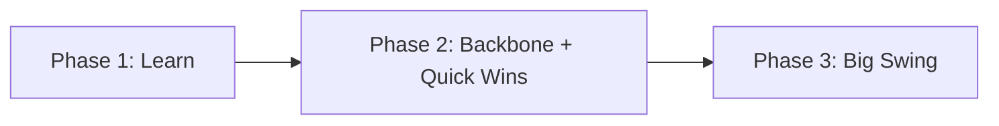

## Phase 1: Learn What Your Fund Needs First

If you’re starting from scratch, use the [portfolio exercise and interview questions](/guide/part-1-understanding-vc/understanding-your-vc-fund) to pick a workflow. If the fund already has a stack, start by following a deal through it.

### When You Inherit a Stack That Nobody Really Uses

An established fund can have plenty of tools without getting much value from them. You arrive to find a CRM, several data subscriptions, a warehouse, and dashboards. On paper, the backbone exists. In practice, partners keep their own spreadsheets and nobody trusts the pipeline report.

Don't start by replacing the CRM. Find out why the current setup isn't working.

- **Inventory what actually runs**: List tools, costs, administrators, integrations, and renewal dates. Check when each sync last succeeded.
- **Follow one real workflow**: Watch a deal move from introduction to partner meeting. Where does information get entered twice? Where do people leave the system? Ask users to show you the last time they used it.
- **Identify trusted data**: Which system does the team rely on for deal status, company identity, and portfolio metrics? Agree on an authoritative source for each. Don't merge conflicting records blindly just to clean up a dashboard.
- **Assign ownership**: Someone needs to own deal updates and someone needs to own the integration that moves them. You can maintain the software, but you can't personally keep every investor's pipeline current.

Pick one workflow and repair it with someone who uses it every week. For example, fix the email sync, remove unnecessary required fields, and make the Monday pipeline report useful enough that the team stops preparing a separate spreadsheet. Review ambiguous duplicates with the deal team and keep a record of merges.

Measure whether the change sticks. Are active deals updated before the meeting? Has report preparation dropped from two hours to twenty minutes? Are people still maintaining a parallel tracker? Logins alone won't tell you whether you've solved the problem.

Once the workflow works, document it, train the team, and retire the duplicate process. Replace a tool when you've found a specific limitation that matters and can't reasonably fix it through configuration or integration. The quick win may be making something you've already paid for useful.

## Phase 2: Build the Backbone and Quick Wins

**The backbone: CRM and fund operations**

These are non-negotiable infrastructure. Every fund needs to track deal flow and manage fund operations. Don't build these. Buy them.

**CRM**: See [CRM and Deal Flow](/guide/part-2-tech-stack/crm-and-deal-flow). If you already have one, repair the workflow before considering a replacement. If you don't, get one set up and make sure your team actually uses it. If adoption is low, you have a process problem to solve before building anything else.

**Fund operations**: See [Fund Operations](/guide/part-2-tech-stack/fund-operations). If you're Fund I with a small LP base, spreadsheets might work temporarily. But plan the migration before Fund II. Buy this off the shelf. Don't build fund operations software.

**Quick wins: small tools that build trust**

While implementing the backbone, build small tools that solve specific pain points and prove your value to the team. These establish credibility and help you understand what resonates.

Examples of quick wins:

- A simple dashboard showing portfolio company metrics pulled from your CRM
- Automating a painful manual process (generating LP reports, tracking follow-on opportunities)
- A lightweight research workflow improvement (better way to organize market maps, easier way to share insights)
- Customer discovery prospect lists for portfolio companies (using data from PitchBook or LinkedIn)

Quick wins should take days or weeks, not months. They should be immediately useful without requiring behavior change from the team.

## Phase 3: Decide on Your Big Swing

You get one big swing. Maybe it's a research platform. Maybe it's sophisticated sourcing infrastructure. Maybe it's portfolio support tools. Choose based on where your fund's competitive advantage actually is, not what sounds impressive. And maybe you don't need a big swing at all. Many successful funds operate with minimal technology beyond the backbone. Don't build because you think you should.

**Align on data needs and budget first**

Have this conversation before you start: What data sources will this project need? What do they cost? Do we have budget for them? Who approves data spending?

This also applies to engineering resources. If your big swing requires custom development, you need ongoing engineering time to maintain and improve it. Make sure leadership understands this is a strategic investment that requires sustained resources.

If your first project needs to connect companies in the CRM with rounds from a funding feed, start with [Data Modeling](/guide/part-3-technical-foundations/data-modeling) in Part 3.
