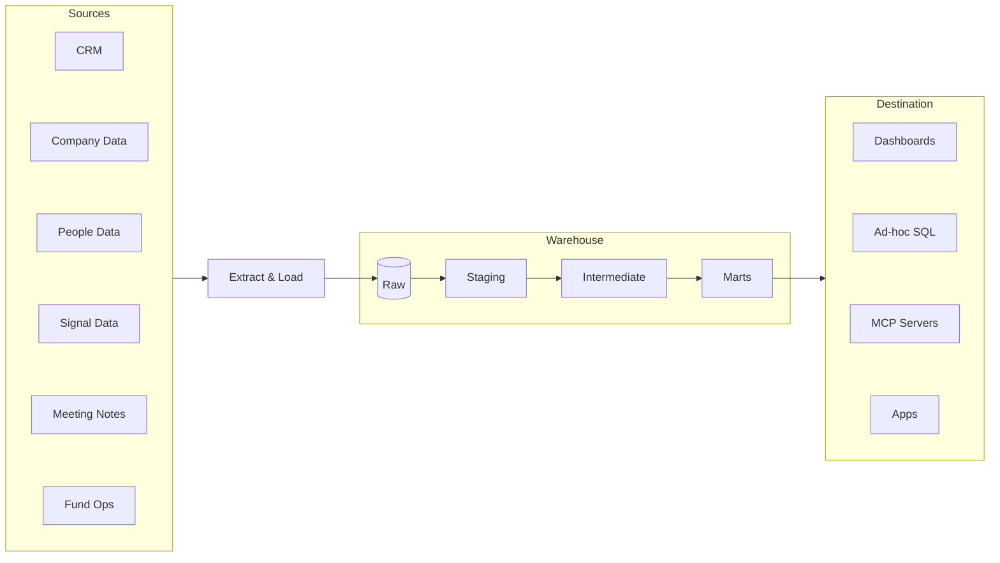

Can your CRM tell you which deals were in diligence at the start of the quarter? If it only shows today’s pipeline, a daily snapshot is a simple way to keep that history.

A data warehouse brings data from different systems together for analysis. Suppose a partner asks what happened to the companies you passed on last year. The CRM has the pass decisions and the funding feed has the subsequent rounds. With both in the warehouse you can join them, then open the original deal notes for the companies that went on to raise.

If the team rarely records a pass in the CRM, start there. A warehouse can preserve the pipeline history you collect. It can’t reconstruct the meetings nobody logged.

## Choosing Your Data Warehouse

Choosing a warehouse is mostly about the queries you're going to run and who has to look after it. The number of companies matters less than whether an analyst can run a market-wide join without slowing the CRM to a crawl.

**For small funds: Start with Postgres**. If you're tracking tens of thousands of companies (not millions), Postgres works fine. It's simpler and cheaper than specialized warehouses, your team already knows it, and you can use the same database for applications and analytics.

Before migrating to a specialized warehouse, consider Postgres extensions: **[pg_mooncake](https://www.mooncake.dev/pgmooncake/)** (Iceberg/Delta Lake format on S3) or **[Hydra](https://github.com/hydradatabase/columnar)** (columnar storage, 200x+ speedups for analytics). These let you keep Postgres while getting analytics database benefits.

**For larger funds: Snowflake, BigQuery, or Redshift**. When Postgres performance degrades (millions of companies, complex aggregations), migrate to a specialized warehouse. [Snowflake](https://www.snowflake.com/en/) (industry standard, cloud-agnostic, expensive), [BigQuery](https://cloud.google.com/bigquery) (fast, Google ecosystem, query-based pricing), or [Redshift](https://aws.amazon.com/redshift/) (AWS integration, cheapest if committed to AWS). Choose based on your cloud ecosystem.

**Migration path**: Start with Postgres. Migrate when query performance becomes painful. The migration is straightforward - you're already structuring data in a warehouse pattern, just moving to a more powerful database.

## The ELT Approach with dbt

The modern approach is ELT (Extract, Load, Transform) using [dbt](https://www.getdbt.com/). Traditional ETL transforms data before loading it. ELT loads raw data first, then transforms it using SQL inside the warehouse. This is simpler because all transformation logic is in SQL, version-controlled, and tested like application code.

**How it works**: Extract data from sources (CRM, PitchBook, LinkedIn) and load it raw into your warehouse using tools like [Fivetran](https://www.fivetran.com/) or [Airbyte](https://airbyte.com/). Write dbt models (SELECT statements) to transform raw data: clean and normalize, combine sources, calculate metrics, build final tables (marts) for analysis. dbt handles orchestration, testing, and documentation automatically. Analysts query the transformed tables, not raw data.

## Organizing Your Data: dbt Best Practices

If you’re setting up a warehouse, I’d start with [dbt’s best practice guides](https://docs.getdbt.com/best-practices). [How we structure our dbt projects](https://docs.getdbt.com/best-practices/how-we-structure/1-guide-overview) walks through a real directory layout and shows where each transformation belongs. Here’s how those layers map to fund data.

- **Staging**: Raw data from sources, lightly cleaned (data types fixed, column names standardized, but otherwise unchanged). One staging model per source table. These models just make raw data easier to work with downstream.

- **Intermediate**: Business logic and transformations. Join data from multiple sources, calculate derived fields, handle entity resolution (linking records across sources). These are building blocks that other models reference.

- **Marts**: Final tables optimized for specific use cases or business domains. These are what dashboards and analyses query. Examples: `companies_enriched` (companies with all their data from multiple sources), `portfolio_performance` (portfolio company metrics over time), `deal_flow_metrics` (pipeline analytics).

**Why this structure works**: Staging isolates you from source changes (if PitchBook changes their schema, you fix the staging model, not every downstream model). Intermediate models are reusable (if multiple analyses need company funding data enriched from PitchBook, build it once in intermediate). Marts are optimized for consumption (denormalized, pre-aggregated, easy to query).

If you’re new to dbt, each model here is a named SQL query. A later model can refer to an earlier one. That gives you somewhere to put the intermediate result that used to live in the second tab of a spreadsheet. A colleague can inspect that step separately when the final total looks wrong.

### Following one source change

Say the Monday pipeline report starts showing fewer companies in diligence. The CRM export still contains the deals, but someone renamed a stage. In a staging model you can inspect exactly what the CRM now calls that field. In an intermediate model you can map the new value to the fund’s definition of diligence. The partner-facing mart can keep exposing the same column as before. Fix the mapping once and you fix the dashboards that read it.

Where you put a transformation matters. If you normalize the stage independently in Hex, the LP report, and a Slack bot, all three can produce different counts from the same CRM export. If one partner wants an exploratory grouping for a meeting, on the other hand, it’s fine for that to start in a notebook. Move it into a shared model once people start depending on the definition.

**Incremental models**: For large tables with historical data (every deal flow snapshot, every change in company data), use incremental models that only process new or changed data rather than rebuilding the entire table. This keeps transformations fast as data grows.

Consider a feed that revises last month’s funding rounds. If your incremental model only selects companies founded since its last run, those corrections never reach the portfolio view. Use the source’s update timestamp or ingestion batches to identify changed records, then rebuild the affected rows. The test is whether the incremental result agrees with a full rebuild for the same source data.

**Tests**: Define tests in dbt for data quality (uniqueness, not null, relationships between tables, custom validations). These run automatically and alert you when data breaks, similar to what we covered in [Data Quality](/guide/part-3-technical-foundations/data-quality) on data quality.

**Documentation**: Document your models, columns, and business logic in dbt. It generates a website showing your entire data model, lineage graphs (which models depend on which), and descriptions of what everything means. This is essential as your warehouse grows and new people need to understand the data.

For a partner looking at a pipeline chart, lineage answers a very practical question. Which CRM field counted a deal as passed, and which transformation turned that field into the number on the chart? Document the definition where you calculate it, so someone tracing an unexpected jump can find the answer.

## Analytics and Dashboards

Different funds care about different metrics. A pre-seed fund might focus on pipeline metrics (how many companies talked to, conversion rates by source, time from first contact to investment). A growth equity fund might focus on portfolio performance (company growth rates, follow-on opportunities, markups/markdowns). A thesis-driven fund might focus on market coverage (how many companies tracked in each thesis area, market maps by sector).

The biggest benefit of having a data warehouse isn't pre-built dashboards. It's being able to answer questions quickly when GPs ask them. "How many companies did we pass on in 2023 that later raised Series B from our target co-investors?" "Which of our portfolio companies are hiring in engineering?" "What's our average time from first meeting to investment decision?"

With data in a warehouse, these queries are straightforward SQL. Without it, they require manually pulling data from multiple systems, matching companies, and piecing together answers. The warehouse makes ad-hoc analysis feasible.

When you do need dashboards, tools like [Hex](https://hex.tech/) or [Mode](https://mode.com/) let you write SQL queries against your warehouse and turn them into interactive visualizations. These are much faster to build than custom dashboards, and they're easy to iterate on and share with the team.

**Examples of common analyses**:

- Pipeline metrics (deals in each stage, conversion rates, time in pipeline, source of deals)
- Market maps (companies in specific sectors, with funding, stage, growth data)
- Portfolio tracking (company metrics over time, which companies need attention)
- Investor analysis (which co-investors appear frequently, warm intro paths to founders)

At Inflection, we used Hex. When a GP wanted to see something, we could spin up a dashboard in an hour or two: write SQL queries against the warehouse, add visualizations, share a link. This responsiveness is valuable. You're not waiting weeks for data engineering to build custom dashboards. You're answering questions as they come up.
