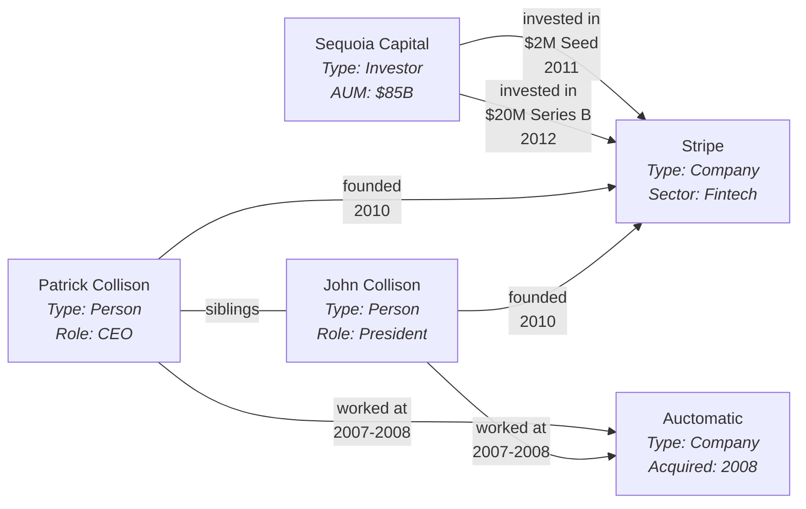

Start with Postgres. Store investments, employment, and board seats as relationships you can query. Before adding a graph database, name a question the team asks often enough to justify keeping a second system in sync.

For example, a partner wants to find founders who previously worked together. A company list won’t tell you that. Follow the founders’ employment records back to their previous company and compare the dates.

## What Are Knowledge Graphs?

In a graph, companies and people are nodes. An edge connects two nodes and describes the relationship. An employment edge can carry start and end dates. Two investment edges can connect the same investor and company at different rounds.

This is a trivial example, but it illustrates how knowledge graphs map entities and relationships. Nodes have properties (company sector, person role, investor AUM) and edges have properties (investment amount, dates). Graph queries can traverse these relationships: "find all companies founded by people who previously worked together" returns Stripe by following the "worked at" edges from the Collisons to Auctomatic. A real knowledge graph would have thousands of nodes and millions of edges, but the structure is the same.

**Graph databases** are databases optimized for storing and querying graph data. They make it efficient to traverse relationships. Instead of joining tables, you follow edges. Queries like "find all companies within 3 degrees of separation from this investor that operate in the same sector" are natural in graph databases but painful in SQL.

**The difference from relational databases**: In a relational database, you might have a companies table, a people table, an investments table that links companies to investors, and an employment table that links people to companies. To answer "which companies did investors who funded my competitor also fund?" requires joining investments table to itself through companies, then joining again to get company details. In a graph database, you start at your competitor node, follow "invested in" edges to investor nodes, follow their other "invested in" edges to company nodes, and you're done.

## When a graph helps

**Market mapping**: When you're researching a sector, you don't just want a list of companies. You want to understand how they relate to each other. Which companies compete directly? Which are upstream suppliers or downstream customers? Which companies were founded by people who worked together previously? A knowledge graph makes it natural to visualize and query these relationships, turning a flat list of companies into a network that shows market structure.

**Competitor analysis**: For portfolio companies or potential investments, understanding the competitive landscape means knowing not just who the competitors are, but how they're connected. Do they share investors? Do they target the same customers? Have they hired from each other? These relationship patterns reveal competitive dynamics that a flat database misses.

**Company similarity**: Finding similar companies is valuable for sourcing (if we liked this investment, what else is similar?) and benchmarking (how does our portfolio company compare to similar companies?). Similarity based on relationships (same investors, same hiring sources, same partners) often reveals more than similarity based on keywords or sector tags. **[EQT's CompanyKG](https://github.com/llcresearch/CompanyKG2)** (1.17M companies, 51M edges representing 15 relationship types) focuses heavily on this, quantifying similarity through network structure and company description embeddings. They benchmarked 11 different methods, validating that relationship data is valuable enough to build serious infrastructure around.

**Network analysis, M&A patterns, investment patterns**: Tracking who knows whom, which investors co-invest, which companies acquire others, which founders worked together. Knowledge graphs make these network queries natural. Understanding acquisition paths, warm intro paths, and investor syndicate behavior all emerge from relationship data.

**Identifying tech hubs**: Knowledge graphs reveal entrepreneurial concentrations. Which companies are "founder factories" (PayPal, Google, Stripe)? Which universities produce the most founders in your sectors? A graph query can show that 15 AI infrastructure companies were founded by people who worked at Meta's infrastructure team, suggesting a network worth watching.

### Deciding whether to add a graph database

**Use knowledge graphs when:**

- Your core queries involve traversing multiple levels of relationships (find companies 2-3 hops away through investor networks)
- You need to visualize network structure (market maps showing company relationships)
- Relationship patterns are as important as entity attributes (co-investment networks, competitive clusters)
- You're building recommendation systems based on graph similarity (companies similar to this one based on their network position)

**Stick with relational databases when:**

- Most queries are about entity attributes, not relationships (show me all Series A companies in fintech)
- Your team is much more comfortable with SQL than graph query languages
- You're still figuring out your data model and need flexibility to change it
- Performance for your use cases is fine with relational databases

**How to implement this**

Keep companies, people, investments, and employment in Postgres. If you want a list of the other companies backed by a particular investor, a join on investor ID is enough. For an occasional network analysis, load the relevant rows into [NetworkX](https://networkx.org/) in Python. You can try a graph algorithm on last quarter’s data without having to operate a second database.

If a tool needs to traverse that network every day, project the same IDs and relationships into a graph database and refresh them when the source changes. Keep stable IDs in the projection so an analyst can trace an unexpected connection back to the source record.

## GraphRAG: Knowledge Graphs for AI Systems

Graph retrieval-augmented generation (GraphRAG) uses relationships to find evidence for a model. Suppose a GP asks for companies connected to a portfolio company’s founders. The founders’ employment records can lead you to research on a previous employer even if the memo never names the portfolio company.

**Use cases**:

- Answering questions about portfolio company relationships ("which of our portfolio companies could partner with each other?")
- Understanding competitive landscapes ("show me companies that compete with our portfolio companies and their relationships to potential acquirers")
- Connecting research insights ("what companies are working in adjacent spaces to this thesis we developed?")
- Due diligence queries ("what are all the connections between this company and our existing network?")

**How it works**: You build a knowledge graph of your companies, people, investors, and their relationships. When someone asks a question, the system:

1. Identifies relevant entities in the question
2. Traverses the knowledge graph to find related entities and relationships
3. Retrieves documents/data associated with those entities
4. Provides both the graph structure and the documents to the LLM
5. The LLM generates an answer informed by both textual content and relationship structure

**Implementation considerations**: GraphRAG requires both a knowledge graph infrastructure and an LLM integration. You need clean entity resolution (covered in [Entity Resolution](/guide/part-3-technical-foundations/entity-resolution)) so the graph accurately represents reality. You need good data quality so the LLM doesn't hallucinate based on incorrect relationships. And you need to decide whether GraphRAG's benefits justify the additional complexity over simpler RAG approaches.

For most funds, this is still emerging territory. Traditional RAG systems work well for searching documents and research. GraphRAG becomes valuable when relationship-based reasoning is critical to answering questions. If you're already building a knowledge graph for market mapping or competitor analysis, adding GraphRAG capabilities might be a natural extension. But don't build a knowledge graph just to enable GraphRAG unless you have validated that relationship-based retrieval solves problems traditional search doesn't.

## Implementation Considerations

**Graph database options:**

- **[Neo4j](https://neo4j.com/)**: Most popular graph database, mature ecosystem, Cypher query language. Good developer experience and tooling.
- **[Amazon Neptune](https://aws.amazon.com/neptune/)**: Managed graph database on AWS, supports both Gremlin and SPARQL. Good if you're already on AWS.
- **[Memgraph](https://memgraph.com/)**: In-memory graph database startup with focus on streaming data and real-time analytics. Compatible with Neo4j's Cypher query language.
- **[FalkorDB](https://www.falkordb.com/)**: Graph database startup built on Redis, emphasizing low latency and high throughput. Also uses Cypher. Good for real-time applications.

**Data modeling**: Graph data modeling is different from relational modeling. You need to think about what should be nodes vs. properties (is a funding round a node or a property of an investment edge?), how to model time-varying relationships (person worked at company from date X to date Y), and how to handle different relationship types with different semantics.

A funding round makes the choice concrete. If you only want a path from an investor to a company, an investment edge with a date might be enough. If a GP asks who invested _together in the same round_, two edges pointing at a company won’t answer it. One investor could have entered at seed and the other five years later. Give the round its own identity and link both investors to that round.

**Query performance**: Graph databases are optimized for traversals, but performance depends heavily on your graph structure and query patterns. Highly connected nodes (like major investors) can become bottlenecks. You may need to denormalize data or add specialized indexes.

**Data freshness**: If you're maintaining both a relational database and a graph database, you need to keep them in sync. This usually means ETL processes that run periodically (nightly or weekly). Real-time sync is possible but adds significant complexity.

**Team expertise**: Graph databases require different mental models than relational databases. Your team needs to learn graph query languages, understand graph algorithms, and think differently about data modeling.
